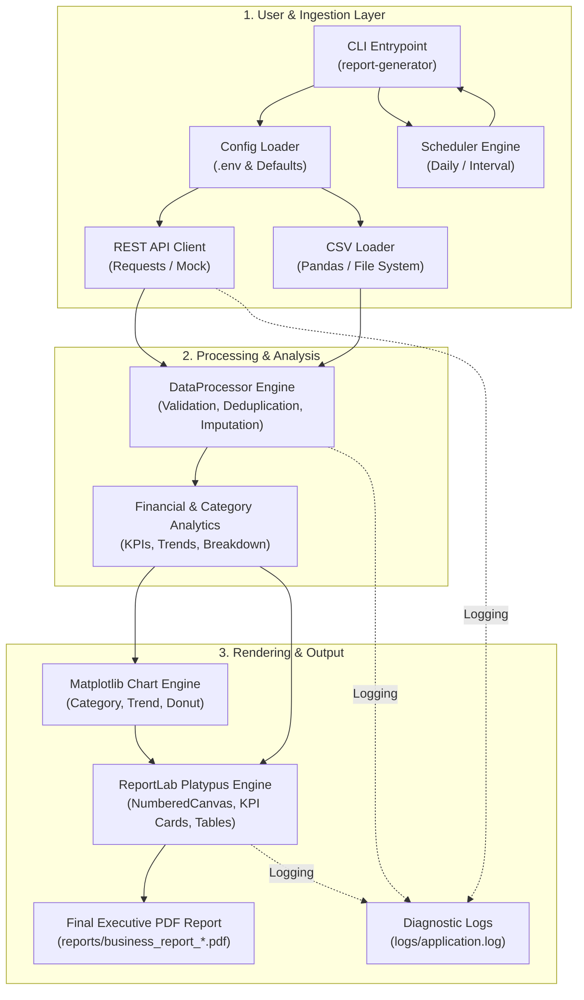
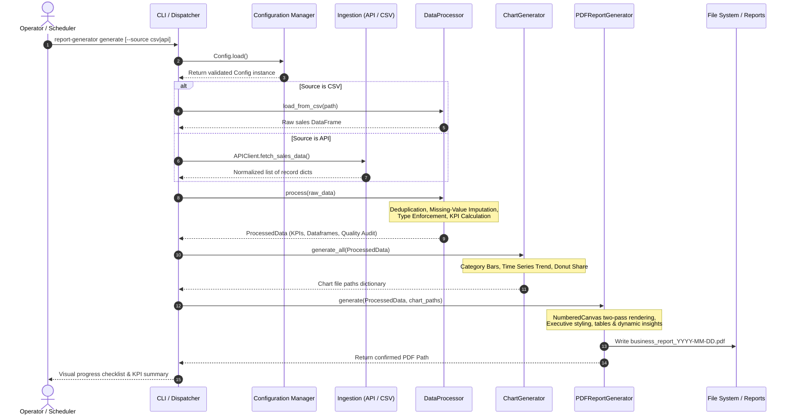

# System Architecture & Technical Design Document

## Enterprise Python Automation – Automated PDF Business Report Generator

---

## 1. Executive Summary

The **Enterprise PDF Business Report Generator** is an enterprise-grade automation framework designed to ingest, validate, analyze, visualize, and compile periodic sales and operational performance records into publication-quality executive PDF documents.

The architecture emphasizes modularity, separation of concerns, defensive programming, automated scheduling, and resilience against network or data integrity failures.

---

## 2. End-to-End Architecture Flow

---

## 3. High-Level Execution Sequence

---

## 4. Component Deep Dive

### 4.1 CLI Layer (`src/report_generator/cli.py`)
- Provides clean subcommands: `generate`, `schedule`, and `version`.
- Coordinates the pipeline steps sequentially (`[1/5]` to `[5/5]`).
- Intercepts domain exceptions (`APIClientError`, `DataProcessingError`, etc.) and presents clean, user-friendly messages without exposing raw Python tracebacks to stderr, while logging the complete traceback to `logs/application.log`.
- Implements `safe_print` encoding fallbacks to ensure compatibility across diverse OS terminal encodings (e.g. Windows `cp1252`).

### 4.2 Configuration Manager (`src/report_generator/config.py`)
- Centralizes runtime settings utilizing `python-dotenv`.
- Validates numeric boundaries (e.g. `API_TIMEOUT > 0`).
- Dynamically resolves and creates project directories (`reports/`, `logs/`, `charts/`, `data/`).
- Prevents hardcoded credentials by sourcing secrets strictly from `.env` or system environment variables.

### 4.3 REST API Client (`src/report_generator/api_client.py`)
- Encapsulates `requests.get` with deterministic timeouts and authentication headers (`Bearer <token>`).
- Normalizes irregular upstream payload schemas (nested `data`, `sales`, `products` wrappers).
- Includes an internal `mock://enterprise-sales-api` simulation layer allowing full functional testing in isolated or offline environments.
- Distinguishes network connection drops, HTTP 4xx/5xx errors, timeouts, and JSON parsing failures.

### 4.4 Data Processing & Analytics Engine (`src/report_generator/data_processor.py`)
- **Deduplication:** Detects and drops identical duplicate transaction records.
- **Missing Value Handling:** Recomputes `revenue = quantity * unit_price` when missing; handles null categories and products with corporate defaults.
- **Type Coercion:** Guarantees strict integer quantities, float currencies, and normalized ISO-8601 dates (`YYYY-MM-DD`).
- **Statistical Aggregation:** Computes gross sales, average transaction value, min/max metrics, category volume distribution, and temporal sales trajectories.
- **Audit Logging:** Yields a `quality_metrics` summary documenting all data cleaning transformations.

### 4.5 Visualization Engine (`src/report_generator/charts.py`)
- Built on `matplotlib` with the non-interactive `Agg` backend to avoid GUI window dependencies in automated environments.
- Generates 300 DPI publication-quality charts:
  1. **Horizontal Bar Chart:** Category-wise revenue performance with formatted currency labels.
  2. **Trend Chart:** Chronological daily/monthly revenue progression with shaded area beneath the line.
  3. **Donut Contribution Chart:** Percentage market share across business verticals.

### 4.6 PDF Document Generator (`src/report_generator/pdf_report.py`)
- Built using ReportLab's **Platypus** framework (`SimpleDocTemplate`, `Paragraph`, `Table`, `Image`).
- Employs a custom `NumberedCanvas` utilizing a two-pass rendering strategy to calculate total page count (`"Page X of Y"`).
- Features executive KPI cards, an audit table, high-resolution visual charts, alternating row styling for category performance, and algorithmic business recommendations.

### 4.7 Scheduler Engine (`src/report_generator/scheduler.py`)
- Built on the `schedule` library.
- Supports daily recurring execution at a designated 24-hour timestamp (e.g. `--daily --time 09:00`) as well as interval scheduling (e.g. `--interval 60`).
- Features exception containment, preventing background loops from terminating on transient job errors.

### 4.8 Centralized Logging Module (`src/report_generator/logger.py`)
- Writes rotating or appended logs to `logs/application.log`.
- Configurable log levels (`DEBUG`, `INFO`, `WARNING`, `ERROR`, `CRITICAL`).
- Decouples console reporting from background logging to keep terminal presentation pristine.

---

## 5. Security & Reliability

1. **Zero Secrets in Code:** Sensitive API credentials are never hard-coded and are strictly excluded from source control via `.gitignore`.
2. **Path Sanitization:** Input file paths and output directory structures are validated to prevent directory traversal or file destruction.
3. **Graceful Degradation:** When upstream REST APIs fail, the CLI issues a managed error without process crash, while the application supports immediate offline CSV execution.
4. **Memory Management:** All Matplotlib figures and file handles are explicitly closed to avoid resource leaks during long-running background scheduler sessions.
